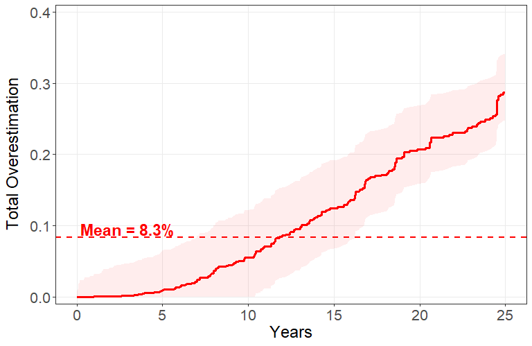

<!-- README.md is generated from README.Rmd. Please edit README.Rmd only. -->

# kmaudit

<!-- badges: start -->

<!-- R-CMD-check and MIT badges added for v1.0.0 -->

[](https://doi.org/10.5281/zenodo.24134374)
[](https://github.com/fespuny/kmaudit/actions/workflows/R-CMD-check.yaml)
[](LICENSE.md)
<!-- badges: end -->

`kmaudit` provides a lightweight diagnostic layer for assessing
Kaplan-Meier (KM) risk overestimation in competing-risks analyses.

**TOD assesses total KM overestimation. KM-CIF provides event-specific
quantification when needed. OI interprets temporal event allocation.**

## Installation

Install the current release from GitHub:

``` r
# install.packages("pak")
pak::pak("fespuny/kmaudit")
```

## Quick start

The example below uses the 25-year MGUS competing-risks analysis from
the accompanying methodological article.

``` r
library(kmaudit)

fit <- tod(mgus$time, mgus$ev)

summary(fit, times = 25)
confint(fit, times = 25)
```

At 25 years, TOD is approximately **0.287**: the summed cause-specific
KM risks exceed the corresponding cumulative incidences by approximately
**28.7 percentage points**.



TOD is non-negative and accumulates monotonically over follow-up. Its
confidence interval follows directly from Product Limit Error
Equivalence.

## Audit workflow

1.  **Assess total KM overestimation with TOD.**  
    Judge its magnitude in the context of the scientific application.

2.  **Examine an event of interest when necessary.**  
    If TOD is non-negligible and interest centres on a particular event,
    compare its naive KM risk with the corresponding cumulative
    incidence.

3.  **Interpret temporal event allocation with OI.**

## Order Index

OI summarises pairwise temporal ordering relative to an event of
interest:

``` r
oi( mgus$time, mgus$ev, interest = 1, competing = 2 )
```

For the MGUS cohort, OI is approximately **0.502**.

- **OI near 0:** the event of interest tends to occur earlier;
- **OI near 1:** competing events tend to occur earlier;
- **OI near 0.5:** temporal ordering is approximately balanced.

OI is interpretive rather than a measure of overestimation magnitude.

## Full worked example

The flagship vignette demonstrates the complete audit workflow using the
MGUS cohort, including TOD inference, event-specific KM-CIF
quantification, and OI interpretation:

``` r
vignette("kmaudit", package = "kmaudit")
```

## Reproducing the paper

The released materials reproduce the reported manuscript figures,
tables, model fits, and validation results from the archived analysis
data and public benchmark datasets.

See [`paper/README.md`](paper/README.md) for the complete reproduction
guide.

``` r
source("paper/reproduce.R")
```

Generated reproduction outputs can be removed with:

``` r
source("paper/clean_reproduce.R")
```

## Scope

`kmaudit` is a diagnostic layer for standard competing-risks analyses.
It does not replace Kaplan-Meier, Aalen-Johansen, regression, or other
established survival-analysis methods.

The current implementation assumes a standard competing risks setting
with independent right censoring.

## Citation

If `kmaudit` contributes to an analysis, please cite the software and
accompanying methodological article:

``` r
citation("kmaudit")
```

## Licence

The `kmaudit` software is released under the MIT Licence.

Analysis data generated for this study are released under the Creative
Commons Attribution 4.0 International (CC BY 4.0) licence. Third-party
datasets retain their original licences and terms of use.

See [`LICENSING.md`](LICENSING.md) for details.
